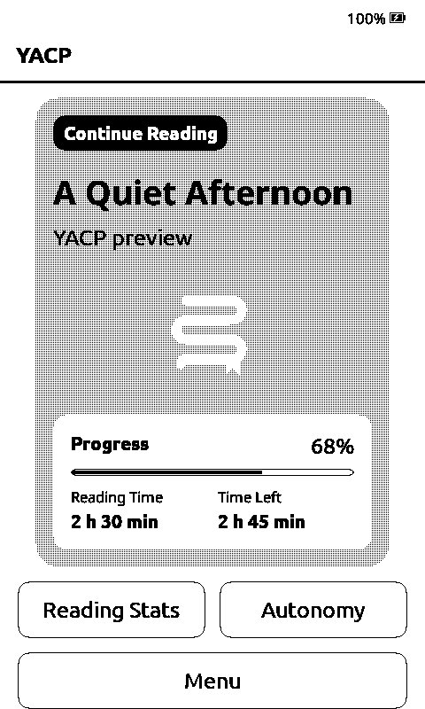
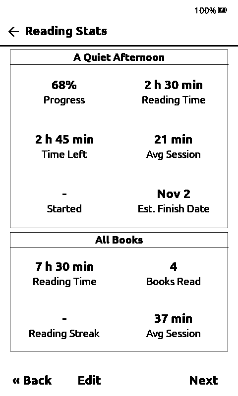

# YACP

YACP is open-source firmware for Xteink readers. It prioritizes battery efficiency, responsive reading and avoiding unnecessary work on the reading path.

Read EPUB, TXT and XTC/XTCH books, resume your current page, and save reading preferences for each book.

[Downloads](https://github.com/Sichroteph/YACP/releases) | [User guide](USER_GUIDE.md) | [Report a bug](https://github.com/Sichroteph/YACP/issues)

## How YACP limits work

- **Home uses saved book data.** Progress and reading durations load for the selected book when you enter Home or change the selection. Painting Home does not open the book or scan global statistics.
- **EPUB statistics are saved at session end.** Reading time and page-turn samples accumulate during the session, then save when you leave the reader, including for sleep.
- **Sleep images are prepared in your browser.** Your phone or computer resizes and converts images before upload. The reader receives prepared files.
- **Dictionary lookups run when requested.** Normal reading does not perform dictionary lookups in the background.

These choices limit CPU and SD-card work. Battery life and page-turn latency depend on the reader, screen mode, font and workload.

## Reading features

- **Quick Resume:** keep the current reading page visible during sleep. Wake the reader to continue or turn the page.
- **Home:** resume the selected book or switch to another recent book. Its progress, reading time and estimated time left appear on the same screen.
- **Per-book preferences:** adjust the font, size, spacing and other reading options for individual books.
- **Reading statistics:** per-book and global totals, session duration, daily and weekly history, and completed-book records. Time-left values are estimates based on reading pace.
- **Autonomy view:** compare battery level with active use and displayed reader pages during a battery cycle.
- **Library and transfers:** folders, recent books, cover grids, EPUB chapters, bookmarks and footnotes. Use the web file portal, OPDS or Calibre wireless workflows to transfer books.

<p>
  
  
</p>

English development simulator captures with illustrative reading data.

## Per-book sleep galleries

Assign several images to a book. In gallery sleep mode, each sleep selects an image at random from that book's gallery. A general gallery is the fallback. Quick Resume is an alternative sleep-screen choice.

**The next beta adds online cover search and batch preparation.** In the web portal, choose a book, search Open Library by title and author, select covers from its editions, adjust the crop and grayscale, then convert and upload the selection. Local image import remains available offline.

[See the cover workflow](docs/images/releases/1.9.0-beta1/YACP-book-gallery-walkthrough.gif): six covers selected, converted and uploaded to an isolated simulator gallery. The edited sequence does not measure processing speed.

## Fonts, CJK and dictionary

YACP 2.0.0 includes **Atkinson Hyperlegible Next** and **Lexend Deca** at 12, 14 and 16 pt. Use a compatible SD-card font for larger text. After updating from XLarge, a saved 18 or 20 pt setting for a built-in font uses 16 pt. Older releases list their available sizes in their release notes.

Add compatible SD-card fonts for Chinese, Japanese, Korean or other scripts. A font must contain the characters your books use. CJK fonts are installed separately. See the [SD-card font guide](docs/sd-card-fonts.md) for device-dependent formats and installation.

The offline dictionary opens a definition over the EPUB page. On X4 Pro, hold the word; on readers with physical controls, select it with the buttons. Install dictionary files on the SD card first. See [dictionary setup](docs/dictionary.md).

## Models and releases

**Stable 1.7.1** supports X3 and original X4. **YACP 2.0.0 is in preparation**, including separate Classic and Pro builds. Source support and a successful compilation do not establish hardware validation or a published release.

| Model | Firmware family | Device-specific controls |
| --- | --- | --- |
| X3 | Shared X3 / original X4 | Physical buttons, optional tilt page turning |
| Original X4 | Shared X3 / original X4 | Physical front and side buttons |
| X4 Classic | Classic | Physical controls |
| X4 Pro | Pro | Touch, Home key, frontlight, USB drive mode |

YACP 2.0.0 ships a Standard image for each firmware family.

**Magic Flash:** X3 retains its own implementation. The next beta extends text-page reinforcement to original X4 and Pro screens identified as UC8279 with LUT 0x68. Christophe has tested his matching Pro; matching original X4 hardware still needs reports. Other panels and X4 Classic are outside this extension. Classic refresh remains available.

On Pro, the reading status bar shows whether the frontlight is on. This helps identify a light left on in daylight and switch it off when unnecessary.

## Download and update

1. Open [YACP Releases](https://github.com/Sichroteph/YACP/releases) and read the selected release's compatibility and test status.
2. Back up the SD card, including reading data and saved settings.
3. Select the Standard firmware for your exact model. Check the supplied hash and follow the release's installation instructions. When updating from XLarge, copy the new Standard image to the SD card and use **SD Card Firmware Update**.

When moving from an older YACP base, consult the [migration status](docs/yacp-migration.md). Keep the pre-update SD backup and the firmware for your exact model and variant if you might want to switch back.

Older preferences and reading positions may not carry over when switching to the CrossPoint base. If an import or its backup fails on a readable card, YACP keeps access to the library and books using fresh reading data in `/.yacp-reading-v1`. New preferences and positions are saved there and reused after restart, while the old data and any unfinished migration stay preserved. Automatic import is skipped once this separate reading store exists. A folder named `pending` is an incomplete backup. Keep the complete pre-update card backup for rollback.

### Return to the previous firmware

Reinstall the exact firmware you were using and boot it with the original SD card or a card restored from the complete pre-update backup. If you plan to try YACP on a second card, keep the original card intact. Restoring the backup takes reading positions, bookmarks and statistics back to the time of that backup.

YACP preserves the original `.crosspoint` directory before it starts using your reading data. Look for the archive that matches your starting firmware:

- Older YACP based on CrossInk: `/.yacp-migration-v1/original`.
- Earlier YACP based on CrossPoint: `/.yacp-source-backup/pre-crosspoint-2.0`. This snapshot is made once, before the reader changes its saved data for the new reading engine.
- CrossPoint or official CrossInk: `/.yacp-source-backup/original`. YACP copies the directory once and keeps it for rollback. The SD card needs space for a second copy of `.crosspoint`. If the copy is interrupted, restart YACP to resume. If the card is full, make space for the copy or use a larger card with the same contents.

When a CrossInk card has only `crossink-settings.json`, YACP imports the compatible reading and display preferences. If the card also has a native `settings.json`, that profile takes priority. The archive retains both files so either can be recovered.

For a copy you can keep off the SD card, save the entire matching archive directory as a ZIP on your computer. Extract it before restoring it as `.crosspoint`.

If you have no pre-update card backup, you can recover the archived directory as follows:

1. Turn the reader off. Open the card on a computer and show hidden files. Locate the archive directory for your previous firmware listed above. A directory named `pending` or ending in `.pending` is an incomplete backup.
2. On a spare card, copy your books, fonts and other personal files, keeping the same names and folder paths. Copy the entire archive directory to the root of the spare card and name the copy `.crosspoint`. Leave the migration folders on the trial card.
3. Reinstall your previous firmware and start it with the restored card. Check a previously opened book, a bookmark, reading statistics and saved Wi-Fi where supported. Keep the trial card if you want to retain changes made during the trial.

These archives cover `.crosspoint` and reside on the same SD card. Keep a separate complete SD backup and confirm the firmware reinstall procedure before switching to YACP. Factory Xteink data requires that separate backup.

## Other options

- Settings grouped into Display, Reader, Controls and System subpages in the next beta.
- Button mapping, separate long-press actions, orientation and automatic page turning.
- Focus Reading, Guide Dots, reader-only dark mode and status-bar controls.
- Manual and supported automatic reading-data backups.
- Optional KOReader SmartSync.

See the [changelog](CHANGELOG.md) for version-specific additions and fixes.

## Development

The active YACP source uses **CrossPoint 2.0.0 and its pinned FreeInk SDK**. Earlier YACP releases used CrossInk. This branch is the single active source for all four Xteink models.

Read the [source policy](docs/yacp-source-consolidation.md), [feature and validation matrix](docs/yacp-port-matrix.md) and [project layout](docs/yacp-project-layout.md) before building. PlatformIO supplies the toolchain; YACP builds use the guarded wrapper:

```sh
python scripts/check_yacp_source.py
python scripts/build_yacp.py all-local
```

The source check requires the registered worktree described in the source policy. The wrapper reserves a new embedded build version, builds all three Standard firmware profiles and records artifact identity. Simulator builds use the same wrapper with an existing WSL mirror. For a different registered distribution, pass its name and the path to its PlatformIO executable, for example:

```powershell
python scripts/build_yacp.py simulator_x3 --wsl-mirror /home/yacp-simulator/crosspoint-200 --wsl-distro YACP-Simulator --wsl-pio /home/yacp-simulator/venv/bin/pio
```

Direct PlatformIO builds bypassing the wrapper are refused.

No build or simulator result replaces device testing. Bug reports should include the exact reader model, full embedded version, font variant, reproduction steps and expected versus observed behavior.

## Credits and support

Christophe has continued development since the last stable release. A reader donated the X4 Pro used for Pro development and testing. Thank you to that anonymous donor, the testers and contributors.

YACP builds on [CrossPoint Reader](https://github.com/crosspoint-reader/crosspoint-reader), [FreeInk SDK](https://github.com/Free-Ink/freeink-sdk) and earlier [CrossInk](https://github.com/uxjulia/CrossInk) work. Imported code, fonts, dictionaries and cover artwork retain their respective credits and licenses. Release notes identify contributions included in each version.

Optional support: [PayPal](https://www.paypal.com/paypalme/ChrJeannette). Releases have no fixed schedule.

## License

YACP retains the upstream [MIT license](LICENSE). It is not affiliated with Xteink or any device manufacturer.
